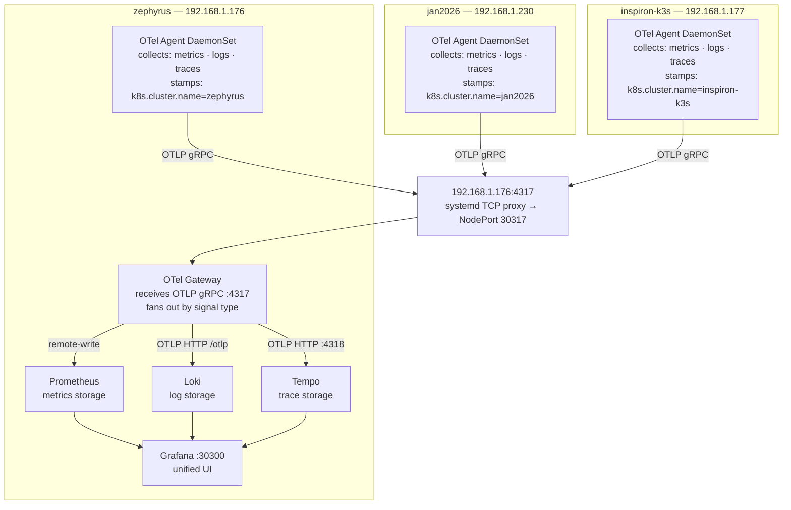

# homelab-observability


Central observability platform for all homelab Kubernetes clusters. Metrics, logs, and traces from multiple clusters now flow into a single Grafana instance on `192.168.1.176`, with `192.168.1.230`, `192.168.1.177`, and `192.168.1.176` acting as sources.

---

## Architecture



### Hub: 192.168.1.176 (ron-goodman) — reunion Kind cluster

| Component | Chart | Namespace | Status |
|---|---|---|---|
| OTel Collector (gateway) | open-telemetry/opentelemetry-collector | observability | Target state: running on `192.168.1.176` |
| Prometheus + Grafana | prometheus-community/kube-prometheus-stack | observability | Target state: running on `192.168.1.176` |
| Loki | grafana/loki | observability | Target state: running on `192.168.1.176` |
| Tempo | grafana/tempo | observability | Target state: running on `192.168.1.176` |

### Source Clusters

| Cluster | Host | Login | OTel Agent | ArgoCD |
|---|---|---|---|---|
| jan2026 | 192.168.1.230 | rongoodman | Enabled and exporting to `192.168.1.176` | https://goodmanreunion.duckdns.org/argocd |
| inspiron-k3s | 192.168.1.177 (Dell Inspiron 3668, k3s) | rawhideron | Enabled and exporting to `192.168.1.176` | — |
| zephyrus | 192.168.1.176 | ron-goodman | Enabled and exporting to `192.168.1.176` | — |
| zephyrus-k3s | 192.168.1.176 (k3s, same host) | ron-goodman | Enabled and exporting to `192.168.1.176` | — |

---

## Accessing the UIs

### Grafana — primary UI for all signals

| URL | Credentials |
|---|---|
| http://192.168.1.176:30300 | admin / *(retrieve with `kubectl get secret -n observability grafana-admin-credentials -o jsonpath='{.data.admin-password}' \| base64 -d`)* |

Grafana has Prometheus, Loki, and Tempo pre-wired as datasources. This is the main
interface for querying metrics, browsing logs, and viewing traces. Loki and Tempo
have no standalone UI — use Grafana for everything.

**Changing the admin password:**

```bash
observability/change-grafana-password.sh <new-password>
```

This updates the `grafana-admin-credentials` secret in-cluster and restarts Grafana to pick it up.

**Recommended dashboards** (import via Dashboards → New → Import):

| ID | Name | Datasource | Description |
|---|---|---|---|
| 315 | Kubernetes cluster overview | Prometheus | Pod counts, deployments, namespaces, and resource usage across the cluster |
| 1860 | Node Exporter Full | Prometheus | Detailed per-node CPU, memory, disk, and network metrics from node-exporter |
| 15141 | Loki Kubernetes Logs | Loki | Browse and search container logs by namespace, pod, and stream |


### Prometheus (always accessible)

Open: http://192.168.1.176:9090

Forwarded by the `otel-forward` systemd proxy (NodePort 30900 → host port 9090).

**Example queries** (one at a time in the Query box):

```promql
# CPU usage % across all nodes
100 - (avg by(instance) (rate(node_cpu_seconds_total{mode="idle"}[5m])) * 100)

# Memory usage %
(1 - node_memory_MemAvailable_bytes / node_memory_MemTotal_bytes) * 100

# Disk usage %
(1 - node_filesystem_avail_bytes{mountpoint="/"} / node_filesystem_size_bytes{mountpoint="/"}) * 100

# Kubernetes metrics from source clusters (OTel-forwarded)
k8s_node_cpu_usage_nanocores{k8s_cluster_name="jan2026"}
k8s_node_cpu_usage_nanocores{k8s_cluster_name="inspiron-k3s"}
k8s_node_cpu_usage_nanocores{k8s_cluster_name="zephyrus"}

# See all cluster names with data
count by(k8s_cluster_name) (k8s_node_cpu_usage_nanocores)
```

### Alertmanager (always accessible)

Open: http://192.168.1.176:9093

Forwarded by the `otel-forward` systemd proxy (NodePort 30903 → host port 9093).

### Loki (API only)

```bash
kubectl port-forward svc/loki -n observability 3100:3100 --address 0.0.0.0
```

Open: http://192.168.1.176:3100

---

## Grafana Setup

### Recommended dashboards

Import via **Dashboards → New → Import → enter ID → Load**

| ID | Description |
|---|---|
| 315 | Kubernetes cluster overview |
| 1860 | Node Exporter Full (host metrics) |
| 15141 | Kubernetes pods / Loki log viewer |

### Cluster filter variable

**Kubernetes / Multi-cluster (OTel)** (`/d/k8s-multi-cluster`) is provisioned
from `observability/dashboards/kubernetes-multi-cluster.json` by
`rebuild-hub.sh` (a ConfigMap labelled `grafana_dashboard=1`). It has Cluster →
Node / Namespace → Pod dropdowns and only uses kubeletstats metrics, which
every source cluster ships. To apply a change to the JSON without a full
rebuild, run the `create configmap … | kubectl apply` step from `rebuild-hub.sh`.

The built-in kube-prometheus-stack and imported dashboards (315, 1860) can't
switch clusters: they use Prometheus-native metrics (`kube_*`,
`container_*_seconds_total`, `node_*`) that only the hub's own scrapes produce,
and their hidden `cluster` variable reads a `cluster` label nothing sets.

**Hosts (OTel)** (`/d/homelab-hosts`, from `observability/dashboards/hosts.json`)
is the per-machine view: CPU, load, memory, filesystems, disks, NICs and TCP
connections for every host running the standalone host agent (currently pop-os,
the Zephyrus hub and the Dell at 192.168.1.177). Every kind/k3s cluster runs on one of those machines, so
use it instead of Node Exporter Full (1860), which only sees the hub's kind
nodes. The in-cluster agents' `system_*` metrics are left out: they report
host-wide CPU/memory once per node and only the agent pod's own network.

To add the same selector to another dashboard:

| Field | Value |
|---|---|
| Name | `cluster` |
| Type | Query |
| Data source | Prometheus |
| Query | `label_values(k8s_node_cpu_usage, k8s_cluster_name)` |

Namespace drill-down variable:
```
label_values(k8s_namespace_name{k8s_cluster_name="$cluster"}, k8s_namespace_name)
```

---

## Installation

### Prerequisites

- Kind cluster running on each machine
- `kubectl`, `helm` installed
- Helm repos added (see commands below)

### Hub (192.168.1.176)

```bash
cd /home/ron-goodman/Projects/homelab-observability

helm repo add prometheus-community https://prometheus-community.github.io/helm-charts
helm repo add grafana https://grafana.github.io/helm-charts
helm repo add open-telemetry https://open-telemetry.github.io/opentelemetry-helm-charts
helm repo update

kubectl create namespace observability

helm upgrade --install loki grafana/loki \
  -n observability --values observability/loki-values.yaml --wait --timeout 5m

helm upgrade --install tempo grafana/tempo \
  -n observability --values observability/tempo-values.yaml --wait --timeout 5m

helm upgrade --install kube-prometheus-stack prometheus-community/kube-prometheus-stack \
  -n observability --values observability/kube-prometheus-stack-values.yaml --wait --timeout 10m

helm upgrade --install otel-gateway open-telemetry/opentelemetry-collector \
  --version 0.150.1 \
  -n observability --values observability/otel-collector-gateway-values.yaml --wait --timeout 3m
```

Then install the host-side `otel-forward` service so `192.168.1.176:4317`, `:30300`, `:9090`, and `:9093` are forwarded into the Kind cluster across reboots:

```bash
sudo install -m 0755 observability/otel-forward.py /usr/local/bin/otel-forward.py
sudo install -m 0644 observability/otel-forward.service /etc/systemd/system/otel-forward.service
sudo systemctl daemon-reload
sudo systemctl enable --now otel-forward
```

### Source cluster: jan2026 (192.168.1.230)

```bash
helm repo add open-telemetry https://open-telemetry.github.io/opentelemetry-helm-charts
helm repo update
kubectl create namespace otel-agent --dry-run=client -o yaml | kubectl apply -f -
helm upgrade --install otel-agent open-telemetry/opentelemetry-collector \
  --version 0.150.1 \
  -n otel-agent \
  --values observability/otel-collector-agent-values.yaml \
  --set "extraEnvs[0].value=jan2026" --wait --timeout 3m
```

### Source cluster: zephyrus (192.168.1.176)

```bash
helm repo add open-telemetry https://open-telemetry.github.io/opentelemetry-helm-charts
helm repo update
kubectl create namespace otel-agent --dry-run=client -o yaml | kubectl apply -f -
helm upgrade --install otel-agent open-telemetry/opentelemetry-collector \
  --version 0.150.1 \
  -n otel-agent \
  --values observability/otel-collector-agent-values.yaml \
  --set "extraEnvs[0].value=zephyrus" --wait --timeout 3m
```

### Source cluster: inspiron-k3s (192.168.1.177)

Dell Inspiron 3668 (hostname `rawhideron-Inspiron-3668`, login `rawhideron`), single-node k3s hosting the Rancher server (`rancher.goodmanreunion.duckdns.org`) and SonarQube. Until 2026-10-19 its agent used the cluster name `rawhideron` (the machine's login, from when it was the hub at 192.168.1.153) and had been crash-looping since it was installed.

```bash
# k3s's kubeconfig is root-only, so run helm with sudo and give it the chart repo URL
sudo helm --kubeconfig /etc/rancher/k3s/k3s.yaml upgrade --install otel-agent opentelemetry-collector \
  --repo https://open-telemetry.github.io/opentelemetry-helm-charts --version 0.150.1 \
  --create-namespace -n otel-agent \
  --values observability/otel-collector-agent-values.yaml \
  --set "extraEnvs[0].value=inspiron-k3s" --wait --timeout 3m

# Host metrics + journald (the Hosts dashboard)
bash observability/host-agent/install.sh
```

### Source cluster: zephyrus-k3s (k3s on 192.168.1.176)

k3s runs directly on the hub host, where `otel-forward` already owns
`0.0.0.0:4317`. `otel-collector-agent-k3s-values.yaml` drops every hostPort (a
k3s hostPort 4317 would DNAT the other clusters' exports away from the hub),
mounts only `/var/log/pods` (containerd) and sets the cluster name.

```bash
K=/etc/rancher/k3s/k3s.yaml
kubectl --kubeconfig $K create namespace otel-agent --dry-run=client -o yaml | kubectl --kubeconfig $K apply -f -
helm upgrade --install otel-agent open-telemetry/opentelemetry-collector \
  --kubeconfig $K --version 0.150.1 -n otel-agent \
  --values observability/otel-collector-agent-values.yaml \
  --values observability/otel-collector-agent-k3s-values.yaml --wait --timeout 3m
```

k3s's kubelet reports no node-level network stats, so the multi-cluster
dashboard's Node network panel shows the sum of pod traffic for it.

### Adding a bare-metal or VM host

Use this for any machine that is not running a Kubernetes cluster — it installs a
standalone `otelcol-contrib` agent that collects host metrics and journald logs and
ships them to the hub gateway at `192.168.1.176:4317`. Hosts that do run kind or
k3s clusters should get it too (pop-os, the Zephyrus hub and the Dell have it): the
in-cluster agents can't see the machine's real disks and NICs, and the Hosts
dashboard lists only machines running this agent.

**1. Copy the host-agent files to the target machine:**

```bash
scp -r observability/host-agent <user>@<host-ip>:/tmp/host-agent
```

**2. Run the installer on the target machine:**

```bash
ssh <user>@<host-ip> "bash /tmp/host-agent/install.sh"
```

The installer will:
- Download `otelcol-contrib` 0.149.0 to `/usr/local/bin/`
- Install the config to `/etc/otelcol-contrib/config.yaml`
- Install and enable the `otel-collector` systemd service

**3. Verify it is running:**

```bash
ssh <user>@<host-ip> "systemctl is-active otel-collector"
```

**4. Confirm metrics are reaching Prometheus** (run on 192.168.1.176):

```bash
kubectl exec -n observability prometheus-kube-prometheus-stack-prometheus-0 -c prometheus -- \
  promtool query instant http://localhost:9090 \
  'system_cpu_time_seconds_total{host_name="<hostname>"}'
```

**Collected signals:**

| Signal | Receiver | Detail |
|---|---|---|
| Metrics | `hostmetrics` | CPU, memory, disk, filesystem, network, load — 30 s interval |
| Logs | `journald` | All units, priority info and above |

Metrics land in Prometheus tagged with `host_name` and `host_ip`, both
auto-detected from the OS at runtime via the `resourcedetection` processor.
No edits to the config are needed before deploying to a new host.

---

## Repository Structure

```
homelab-observability/
├── observability/
│   ├── otel-collector-gateway-values.yaml   # Hub OTel gateway (deployment)
│   ├── otel-collector-agent-values.yaml     # Source cluster agents (DaemonSet)
│   ├── otel-forward.py                      # Host-side TCP proxy for Kind NodePorts
│   ├── otel-forward.service                 # systemd unit for the host-side proxy
│   ├── change-grafana-password.sh           # Rotate the Grafana admin password
│   ├── kube-prometheus-stack-values.yaml    # Prometheus + Grafana
│   ├── loki-values.yaml                     # Log storage
│   ├── tempo-values.yaml                    # Trace storage
│   └── host-agent/                          # Standalone agent for bare-metal/VM hosts
│       ├── otel-collector-config.yaml       # Collector config (hostmetrics + journald)
│       ├── otel-collector.service           # systemd unit
│       └── install.sh                       # Installer script
└── docs/
    ├── observability-plan.md                # Original design plan
    ├── access-guide.md                      # UI access reference
    └── rebuild-guide.md                     # Recreate the hub and agents
```

---

## Signals

| Signal | Collector | Storage | Status |
|---|---|---|---|
| Metrics | kubeletstats + hostmetrics receivers | Prometheus | ✅ Flowing — `k8s_cluster_name` label set |
| Logs | filelog receiver (container logs) | Loki | ✅ Flowing — all namespaces |
| Traces | OTLP receiver | Tempo | 🔵 Ready — requires app instrumentation |

> Traces will populate once application services (e.g. `attendees-api`) are instrumented with the OpenTelemetry SDK to emit OTLP spans.

---

## Networking Notes

Kind nodes run as Docker containers on an internal bridge (172.18.x.x), not directly
reachable from other LAN machines. The hub exposes the OTel gateway via:

1. **NodePort 30317** on Kind node container `reunion-worker2` (resolved dynamically at service start)
2. **Host TCP proxy** on `192.168.1.176` forwards `:4317`, `:30300`, `:9090`, and `:9093` to the active Kind node IP
3. **systemd service** `otel-forward` keeps the forwarding in place across reboots
